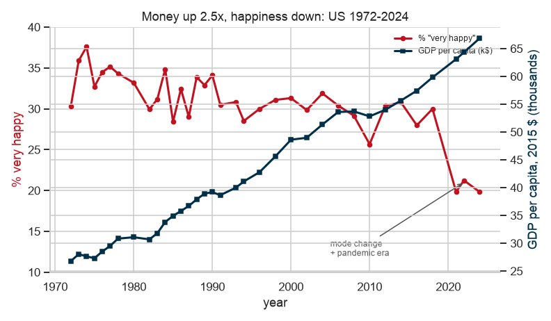

# Kelden Jamtsho

**Data Science Student | Research & Visualization**

[GitHub](https://github.com/KELDENJAMTSHOMC664183) • [Email](mailto:mc664183@um.edu.mo)

---

## About Me
Welcome to my data science portfolio! I specialize in social science data analysis, statistical modeling, and evidence-based data visualization. My work focuses on translating complex empirical datasets—such as multi-decade national surveys and economic indicators—into actionable, clear insights.

---

## Technical Skills

* **Programming & Tools:** Python (`pandas`, `NumPy`, `SciPy`, `statsmodels`), Jupyter Notebooks, Git/GitHub, `uv`
* **Data Visualization:** `Matplotlib`, `Seaborn`, Interactive HTML/CSS Dashboards
* **Statistical Analysis:** Hypothesis Testing (Chi-Square, ANOVA), Regression Analysis, Correlation Metrics (Spearman, Kendall), Odds Ratios & Confidence Intervals
* **Data Engineering:** Survey Data Normalization, Missing Value Imputation, API Data Ingestion

---

## Featured Project

### Money and Happiness in America: Income, Subjective Well-Being, and Economic Growth (1972–2024)

* **Research Question:** 
  > *In the United States of America, how is family income associated with self-reported happiness, and how has this relationship, and the national level of reported happiness, changed between 1972 and 2024 as the country became substantially richer?*

* **Key Findings:**
  * **Cross-Sectional Gradient:** Within any given year, family income is strongly associated with higher happiness ($\chi^2(8) = 2861.3, p < 1\times 10^{-300}$). $39.7\%$ of respondents in the richest income quintile report being "very happy," compared to only $20.7\%$ in the poorest quintile.
  * **The Long-Run Paradox (Easterlin Paradox):** Despite real U.S. GDP per capita growing **2.49×** between 1972 and 2024 (from $\$26,799$ to $\$66,857$), the overall share of Americans reporting to be "very happy" dropped from $30.3\%$ to $19.8\%$.

* **Visualization:**

  *(Dual-axis analysis showing long-run GDP per capita expansion alongside declining subjective happiness trends over 35 GSS survey waves.)*

* **Project Repository:** [CISC7204 - Money and Happiness in America](https://github.com/KELDENJAMTSHOMC664183/data-science-project.git)
* **Project Status:** `Completed`

---

## Contact & Links
* **GitHub Profile:** [github.com/KELDENJAMTSHOMC664183](https://github.com/KELDENJAMTSHOMC664183)